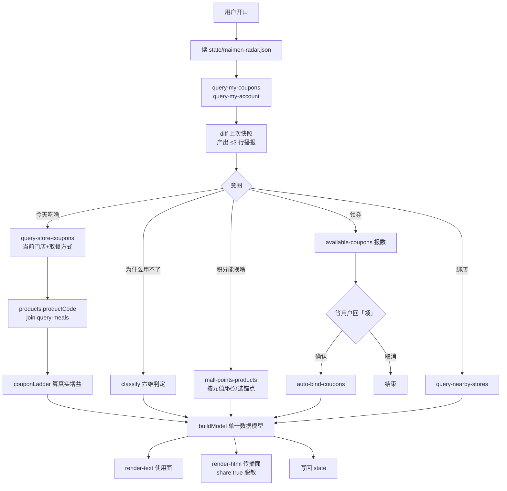

# MCP 集成说明

> 本文记录本项目**实际调用**麦当劳 MCP 服务的情况：用了哪些 Tool、怎么编排、拿到什么结果、以及为什么只用了这些。
> 所有 traceId 与时间戳来自真实响应。真实响应含可核销券码，**不随仓库发布**；本文所列计数、字段结构与 traceId 即为取证。
> 仓库内发布的 `fixtures/` 是由真实响应派生的脱敏样例（餐品、价格、时段窗、星期窗、积分口径全部真实；券码、券 id、accountId、门店名与编码、traceId 已确定性替换），供无 Token 环境跑通 `demo` 与 `check`。

## 1. 接入的服务

| 项 | 值 |
|---|---|
| Server | `mcd-mcp` |
| 版本 | `1.0.0`（`initialize` 握手返回） |
| 接入地址 | `https://mcp.mcd.cn` |
| 传输协议 | Streamable HTTP |
| 鉴权 | `Authorization: Bearer <MCP_TOKEN>`，Token 由 https://open.mcd.cn/mcp 申请 |
| 服务端工具总数 | **35**（`tools/list` 实测） |
| 限流 | 600 次/分钟，超限返回 429 |
| 本项目实际使用 | **9 个 Tool，全部只读** |

Token 只从本地 `.env` 读取，不写进仓库、不进对话、不托管到任何第三方平台。仓库内只提供 `mcp-config.example.json` 占位符配置。

## 2. 实际调用记录

抓取时间：2026-10-18（北京时间），单次会话内连续完成。

| # | Tool | 入参 | 结果 | 服务端时间 | traceId |
|---|---|---|---|---|---|
| 1 | `now-time-info` | — | 11 字段 | 17:08:54 | `a47c9b23cb40efbf72e58106dc70540e` |
| 2 | `query-my-coupons` | 默认分页 | `success:true`，**4 张券**，单张 58 字段 | 16:16:13 | `750cd5392364b4b3833d61437eee07c5` |
| 3 | `query-my-account` | 无入参 | 10 字段积分账户 | 16:17:37 | `96e440eb7ef5b9f6c8115a71f4f8f3b9` |
| 4 | `query-nearby-stores` | `searchType:1, beType:1` | **2 家**收藏门店 | 16:36:32 | `f5e4cef61fdcaceb540013a9f6dcf5a1` |
| 5 | `query-meals` | `storeCode:"1420721", beType:1, orderType:1` | 15 分类 / 110 商品实体 / 122 条引用 | 16:37:33 | `e948fd1f47e2a9f067b2e95674f652c2` |
| 6 | `available-coupons` | — | `success:false, code:499, "No coupons available"` | 17:08:55 | `5afa6d56d2d4a49fc4bc3903bbf197f9` |
| 7 | `campaign-calendar` | — | `currentTime` + 14 天 `dailyList` | 17:08:56 | `4ad33cbea69981f060d120cb59ef5119` |
| 8 | `mall-points-products` | — | **50 个**可兑换商品 | 17:08:57 | `3056b2e0f9a87d6e75d11ef3e9aee52a` |
| 9 | `query-store-coupons` | `storeCode:"1420721", beType:1, orderType:1` | **1 张**可用 | 17:08:58 | `e6da45288e7b5383674270c50ddfb8c2` |
| 10 | `query-store-coupons` | `storeCode:"1420370", beType:1, orderType:1` | **1 张**可用 | 17:08:59 | `f4cbcc8cf542b3a8a452c0062a8939f9` |

**未执行的写操作 Tool**：`auto-bind-coupons`、`create-order`、`cancel-order` 在代码里已接好调用路径，但**本次未实际调用**——写操作须由用户明确确认后触发，而本文档的取证过程全程只读。这一点如实标注，不冒充已验证。

## 3. 调用流程



关键约束：**两个渲染器都只消费 `buildModel()` 的输出，不接触原始 MCP 响应**。脱敏在模型层完成（`share:true` 时渲染器拿不到原始券名、门店名、积分绝对值），因此不存在"HTML 脱敏了、文本版漏了"这类不一致。

## 4. 六维判定与官方结果的一致性校验

`query-my-coupons` 返回的 4 张券，经本项目 `classify()` 判定后，**判为"现在能用"的集合必须与 `query-store-coupons` 的返回集合一致**。这是硬性自检，跑不过就不向用户输出结果。

```
$ node src/check.mjs
✓ 1420721 麦当劳惠州博罗天虹餐厅    官方放行 1 张 / 模型判 now 1 张
✓ 1420370 麦当劳深圳龙胜地铁站D出口餐厅  官方放行 1 张 / 模型判 now 1 张
✓ 积分三向闭合  2163 + 2603.3 + 197.4 = 4963.7 vs accumulative 4963.7
全部通过
```

这条断言在开发中抓到一个真 bug：初版 `classify()` 未校验 `beTypes`，把一张 `beTypes=[4]`（不覆盖到店自取）的冰淇淋券误判为"现在能用"，而官方接口把它滤掉了。补上第六维后两者一致。

## 5. 实测得到的字段事实

完整清单见 `references/fields.md`，这里列影响业务判断的几条：

| 发现 | 影响 |
|---|---|
| `weekdays` 为 **`1=周日，2=周一 … 7=周六`**，空数组＝不限 | 2026-10-19 周一实测判别：`[2,3,4,5,6]` 的券官方周一放行且券面写"周一~五"。此前 10-18 周日的"1=周一"推断属欠定（两映射在周日同判），已被推翻并修正模型 |
| `tradeEndDate` 只到天，`tradeEndDateTime` 到秒，且实测到期时刻全为 `23:59:59` | 倒计时必须用后者，否则"剩 7.7 小时"无从计算 |
| `beTypes` 需与当前取餐场景匹配，`3`/`4` 含义官方未公开 | 判定必须校验；文案只说"不支持当前取餐方式"，不猜含义 |
| `query-store-coupons` 返回**已按门店+业务类型过滤**，且带 `products[].productCode` | ① "能用哪张"不是产品空白，差异化要往"为什么被滤掉"上移；② 券与菜单可硬 join，价格阶梯不用猜 |
| `available-coupons` 用 `code:499 / "No coupons available"` 表达"无券可领" | 重试三次结果一致，是稳定语义。按标准错误处理会给用户弹"服务异常" |
| 严格校验客户端（WorkBuddy 实测）上无券时改抛 `-32602: data/data must be array` | 无券时 `data:null` 过不了 output schema，与 499 同义。skill 按"无券可领"处理，不重试 |
| `mall-points-products` 的 `price` 字段恒为 `0`，真实元值在 `selling` 文案开头 | 金额必须正则解析，不能读 `price` |
| `query-meals` 是归一化结构：`data.meals` 为 `code→实体` 字典，`categories[].meals[]` 只是带 `tags` 的引用 | 直接遍历分类取不到价格 |
| **麦金卡是另一条 SKU code**，靠引用上的 `tags:["麦金卡"]` 识别 | 同一商品两条 code，需按 `name` 归并才能拼出价格阶梯 |
| `campaign-calendar` 正文在 `articleDto.title`，`activityTitle` 常为空串 | 只读 `activityTitle` 会得到一片空白 |
| 服务端 35 个 Tool，官方 README 列 33 个；`query-survey-coupon`、`query-promotions` 未写入文档；`query-partystore-*` 实际已改名为 `query-party-store-*` | 照 README 硬编码工具名会调不到，运行时以 `tools/list` 为准 |
| 积分账户三向闭合：`used + expired + available == accumulative` | 不闭合即数据异常，先报错不计算比例 |

## 6.1 追加取证（2026-10-19，共 13 次只读调用）

| 事实 | 取值 | 影响 |
|---|---|---|
| `weekdays` 映射修正 | `1=周日 … 7=周六`（周一判别性证据） | 模型已修，`check.mjs` 真数据 3/3 通过 |
| id 同源 | 券包 `id` == 门店券 `couponId`（3/3 逐字节） | A2 认亲路径成立 |
| join 断链 | `9900016534`（任选组合）不在菜单字典与引用里 | 该类券不显示"省"，只给问话 |
| 券侧名 ≠ 菜单名 | "麦咖啡™冰美式中杯" vs "麦咖啡™美式" | join 走 `productCode`，阶梯用菜单侧真名 |
| `frequent` 锚点 | `data.frequent = {code:"9900013304", tags:["我的常点"]}` | 排序破平局项（fields.md 已记） |
| `calculate-price` 600010 | 只给 `couponId` 被拒，需 `couponId+couponCode` 双码 | 算价脚本不得回显入参；成功结构已取证（单位分） |
| **静默陷阱（MCD-DEF-001）** | 不带券是合法输入：`200 + discount:0 + 无券价`；错配商品 `600012`；`isError` 恒 false | `discount>0` 是券生效唯一信号；业务失败看响应体；quote.mjs 已加三道闸（bizFail / DISCOUNT_ZERO / 基线自证） |

## 6. 业务价值

**麦当劳的接口会静默滤掉用户用不了的券，并且不说明原因。** 本次实测直接证明了这一点：券包 4 张，`query-store-coupons` 只返回 1 张，另外 3 张分别因星期窗、`enable`、`beTypes` 不匹配被滤除，接口返回里没有任何"为什么"。

本项目把这段被静默处理的信息补回来，并给出出路：

- **为什么不能用** —— 六维判定翻译成人话（"限周二~周六可用，今天周日不行"）
- **什么时候能用** —— 时段条可视化，区分"现在能用 / 今天晚些能用 / 今天用不了"
- **救不救得回来** —— `isCanGive=1` 且 72 小时内到期且本人无可用窗口 → 提示转赠，而不是让它作废
- **券到底值不值** —— 同时报"比原价省多少"和"比菜单现价只多省多少"。实测一张标称省 ¥9.1 的冰美式券，真实增益只有 ¥2.0

积分侧用同一套数据做具象化：实测账户累计赚 4963.7 分、作废 2603.3 分（52.4%），按 `mall-points-products` 中性价比最高的一档（50 分 = 18.8 元两件套）换算，等于**约 ¥978 的饭白白放过**。

## 7. 合规边界

- **不做任何自动化调用**。所有动作由用户开口触发，一次一句。依据《麦当劳 MCP 服务规则》第三条 2 款、第六条 2 款。
- **Token 不出本地**：不提交进仓库、不粘贴进对话、不托管第三方平台（第二条 2 款）。
- **写操作先报数再等确认**：`auto-bind-coupons` 前必先 `available-coupons` 报数量；凭证指令视为用户本人行为（第二条 3 款），故保守设计。
- **产出物默认脱敏**：券码 `code` 可被核销，属敏感信息，任何可分享产出物只显示掩码。
- **口径**：统一为"帮你把权益用满"。不贬低品牌、不与其他品牌对比、不给医疗或营养建议。
- 本项目为参赛者独立开发，非麦当劳官方产品；价格与有效期以麦当劳 App 实时结果为准。
