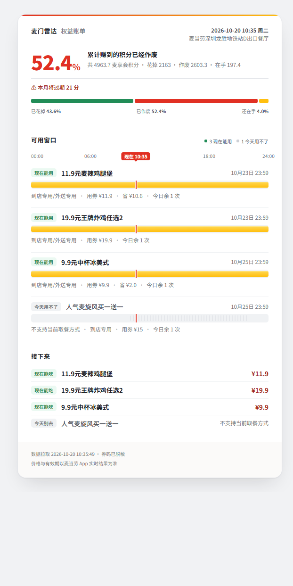
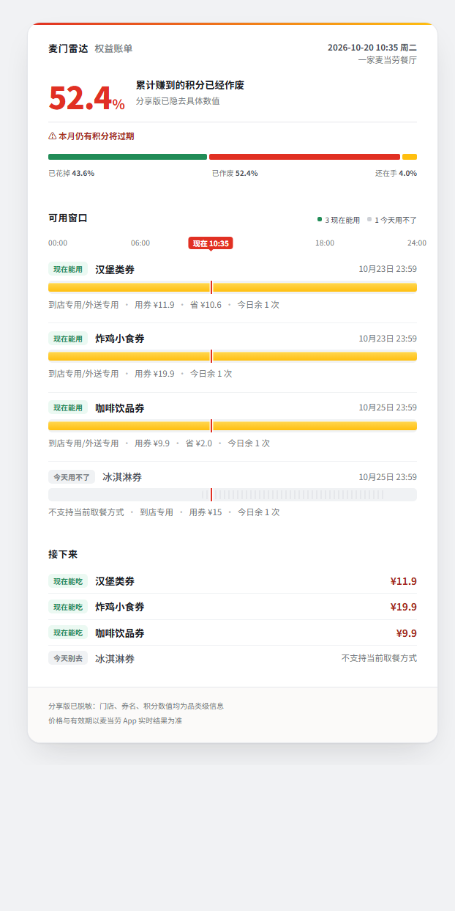
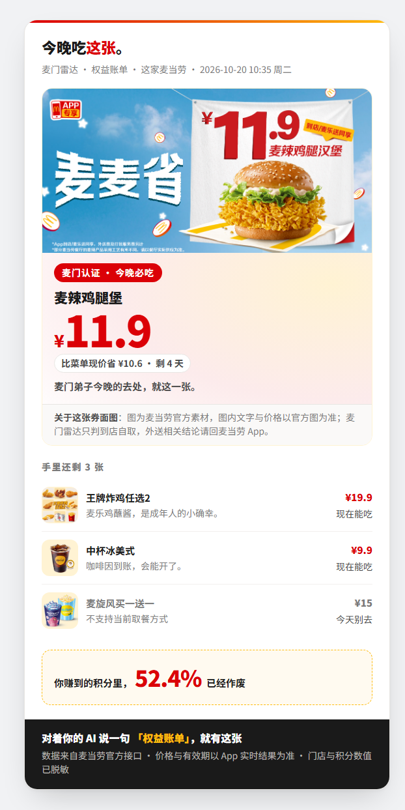

# 📡 麦门雷达 Maimen Radar

> **你赚到的麦麦积分，52.4% 已经白白作废了。**

打开麦当劳 App 的券包，你看到 4 张券。到了店里，可能一张都刷不出来。

麦当劳的接口会**静默滤掉你用不了的券**，一个理由都不给。麦门雷达专门把这段补回来：**为什么不能用、什么时候能用、用不上怎么抢救。**

它不是又一个"帮你省钱"的助手——它敢说"这张券其实只多省 2 块，别为它专门跑一趟"。

---

## 它解决什么

| | 官方券包 | 麦门雷达 |
|---|---|---|
| 哪张券要过期 | ✅ 已有「今日到期」标签 | ✅ |
| **为什么这张现在刷不出来** | ❌ 静默滤除 | ✅ 六维判定 + 一句人话 |
| **今天晚些时候能用吗** | ❌ | ✅ 时段条，一眼可读 |
| **用不上能不能救** | ❌ | ✅ 支持转赠的券自动升级为「送人止损」 |
| **这张券到底省了多少** | ❌ 只报"用券价" | ✅ 同时报真实增益 |
| 积分作废了多少 | ❌ 只有一个数字 | ✅ 换算成"够换 52 份两件套 ≈ ¥978 的饭" |

## 长什么样

在聊天框里，它直接可读——不用打开任何网页：

```
📡 麦门雷达 · 权益账单
   2026-10-18 16:16 周日 · 麦当劳（示例）天虹餐厅 · 券 4 张

   可用窗口            00              12            24
                                           ▾
   ───────────────────────────────────────────────────────────
   🟢 9.9元中杯冰美式      ██████████████████████▓▓▓▓▓▓▓▓ 剩 7.7 小时
      ↳ 到店专用/外送专用 · 用券 ¥9.9 · 省 ¥2.0 · 别为它专门跑一趟 · 今日余 1 次
   🟡 人气麦旋风买一送一   ╌╌╌╌╌╌╌╌╌╌╌╌╌╌╌╌╌╌╌╌╌╌╌╌╌╌╌╌╌╌╌╌ 剩 7.7 小时
      ↳ 不支持当前取餐方式 · 用券 ¥15 · 今日余 1 次
   🔴 11.9元麦辣鸡腿堡     ░░░░░░░░░░░░░░░░░░░░░░░░░░░░░░░░ 剩 6 天
      ↳ 券当前未启用 · 用券 ¥11.9
   🔴 19.9元王牌炸鸡任选2  ░░░░░░░░░░░░░░░░░░░░░░░░░░░░░░░░ 剩 6 天
      ↳ 券当前未启用 · 用券 ¥19.9

💸 你累计赚到 4963.7 麦享会积分
   已花掉 2163（43.6%）· 已作废 2603.3（52.4%）· 在手 197.4
   ⚠ 其中 21 分本月到期

→ 现在能吃：9.9元中杯冰美式 ¥9.9
→ 用不上就送人：人气麦旋风买一送一（支持转赠，过期即作废）
→ 今天别指望：11.9元麦辣鸡腿堡、19.9元王牌炸鸡任选2

→ 说「积分能换啥」看看这些分能换什么　→ 说「生成卡片」出分享版
```

最底下那行不是装饰。你不知道它有那些功能，它每轮只推你一句，功能靠这样一句句发现。

**还有能发群的卡片**——同一份数据渲染，560px 自包含 HTML，浏览器打开截图即走。三张，口径各不相同：

<p align="center">
  
  &nbsp;
  
  &nbsp;
  
</p>

| 左·账单完整版 | 中·账单分享版 | 右·传播版 |
|---|---|---|
| 给自己看：信息密度优先 | 发出去也不露身份 | 发进群让别人问"这什么" |
| 门店名、积分绝对值都在 | 券名收成品类、门店变"一家麦当劳餐厅"、积分只留百分比 | **券名保留真名**、门店变"这家麦当劳"、积分只留百分比，首屏是官方券面图 |

脱敏发生在**数据层**，不在画面上盖遮羞布。传播版为什么把券名换回真名：可核销的是券码不是标题，而"11.9元麦辣鸡腿堡"换成"汉堡券"就没有人想转发——**券名和官方券面图都不敏感，别把它们和券码一起砍掉**。

## 它最诚实的一点

```
9.9元中杯冰美式 → 麦咖啡™冰美式中杯
  原价 ¥19 · 菜单现价 ¥11.9 · 用这张券 ¥9.9

  对外宣传「比原价省 ¥9.1」
  实际比菜单现价只多省 ¥2.0
  ⚠️ 聊胜于无：别为它专门跑一趟
```

`原价 − 券价` 是营销数字，`菜单现价 − 券价` 才是你真省到的。所有省钱工具都在报前者，麦门雷达两个都报，并且敢在你面前说"这张不值得"。

## 它会做什么（全部能力，就这 10 件）

| # | 能力 | 你说一句 | 它给你 |
|---|---|---|---|
| 1 | 领券 | `替我领取麦当劳优惠券` | 先报"现在能领 N 张"，你回一个「领」它才动手；领完再查一次，说清新增了哪几张、哪几张大概用不上 |
| 2 | 权益盘点 | `权益账单` | 券包全景：每张能不能用、不能用的是哪一句原因、积分作废多少、本月将过期多少 |
| 3 | 此刻推荐 | `今天吃啥` | 这家店现在真能刷出来的那一张 + 到手价 + 这家店的实际可刷时段 |
| 4 | 券值不值 | `这张券划算吗` | 原价 / 菜单现价 / 券价三档 + 真实增益 |
| 5 | 到手价 | `算到手价` | 让服务端把带券成交价算出来；券没生效它会直说没生效 |
| 6 | 抢救 | `麦旋风那张为什么用不了` | 人话原因 + 换个取餐方式能不能救 + 能不能转赠止损 |
| 7 | 门店 | `绑一下公司那家店` | 按城市+关键词查店 → 你确认 → 以后按这家算；换店一句话覆盖 |
| 8 | 传播 | `生成卡片` | 两种卡：账单分享版（全脱敏）与传播版（真券名 + 官方券面图），浏览器打开截图就能发群 |
| 9 | 次要 | `最近有啥活动` / `积分能换啥` | 活动日历、把作废积分换算成"够换几份饭"（问才答，不当主打） |
| 10 | 上新 | `上新了什么` | 当期官方"上新"标签的全量新品（现价 + 麦金卡价如有）；权益账单里也常驻一段，不用问就在 |

另外两件事不用你要求它一直在做：**每次开口先补算**（距上次发生了什么——几张券没了、几张现在能用了、多少积分过期），以及**每轮只推一句**（不甩功能表）。

## 它不做什么（边界写死）

- **不替你下单，也不取消订单**——下单相关的接口根本没接入。它告诉你吃啥，下单请去麦当劳 App。
- **不做外送、不做得来速**——只判**到店自取**这一个场景。要点麦乐送，它给不了券的结论，会直接让你去 App。
- **不自动领券**——唯一的写操作是领券，且必须先报数量、等你回一个「领」字。你不点头，它不动。
- **没有任何自动化**——没有定时任务、没有后台脚本、没有跑批。每一次都是你开口触发。
- **不碰配送地址、不建订单**，只读你账户里的券、积分、菜单、活动。
- **不给医疗或营养建议**——成分与热量只做客观展示。
- **不把数据交给第三方**——所有请求只打到 `https://mcp.mcd.cn`；Token 不进仓库、不进对话。

---

## 上手：3 步必做，1 步可选

零依赖，**不需要 `npm install`**。前 3 步做完，对话里的全部功能就能用；第 4 步只影响一件事——「生成卡片」出的是你实时账户的卡，还是样例数据的卡。

### 第 ① 步 · 装（一条命令）

```bash
git clone https://github.com/Reen-ZZ/maimen-radar.git && cp -r maimen-radar ~/.workbuddy/skills/
```

（Windows 为 `%USERPROFILE%\.workbuddy\skills\`。）

### 第 ② 步 · 申请麦当劳 MCP Token（1 分钟）

前往麦当劳 MCP 开放平台 <https://open.mcd.cn/mcp>，手机号登录后进入【控制台】→【激活】→ 同意服务协议 → 复制 Token。

### 第 ③ 步 · 配 MCP 连接器（对话功能全靠这一步）

在 WorkBuddy 左侧边栏【专家·技能·连接器】→【连接器】→ 右上角【自定义连接器】→【配置 MCP】中，
填入 [`mcp-config.example.json`](mcp-config.example.json) 的内容，
并把 `${MCD_MCP_TOKEN}` 替换为你的真实 Token，保存后【启用】。

### 第 ④ 步（可选）· 想让卡片出实时数据，再写一份 `.env`

这里有个容易踩的坑，说清楚：**Token 有两条通道，互不相干。**

| 通道 | 给谁用 | 管什么 |
|---|---|---|
| WorkBuddy 连接器（第 ③ 步） | 对话 | 你在聊天框里说的每一句——领券、账单、今天吃啥 |
| 技能目录里的 `.env`（本步） | 脚本 | 「生成卡片」现拉真实数据时，脚本自己读它 |

一边配了，另一边**不会**自动生效。只配第 ③ 步也能出卡，出的是样例数据的卡——它会明说是样例，不会冒充你的实时账户。

PowerShell 一行搞定：

```powershell
Set-Content "$env:USERPROFILE\.workbuddy\skills\maimen-radar\.env" "MCD_MCP_TOKEN=粘贴你的Token"
```

macOS / Linux：

```bash
printf 'MCD_MCP_TOKEN=粘贴你的Token\n' > ~/.workbuddy/skills/maimen-radar/.env
```

`.env` 已被 `.gitignore` 忽略，仓库里只放 `.env.example` 模板。

> 🔒 **Token 只存在你本地**：别提交进任何仓库、别贴进 AI 聊天窗口、别发到网上（《麦当劳 MCP 服务规则》第二条 2 款）。

## 开聊：按这个顺序说，一句接一句

第一句挑「领券」——它零门槛，不需要门店、不需要 `.env`，而且当场就有产出。之后每一句由它自己往下引：

| 顺序 | 你说 | 会发生什么 | 它把你带到 |
|---|---|---|---|
| **第 1 句** | `替我领取麦当劳优惠券` | 先报"现在能领 N 张"，**等你回一个「领」字才动手**；领完再查一次做对比 | 领到了 → 说清哪几张大概用不上；一张都没得领 → 直接引你说「权益账单」 |
| **第 2 句** | `权益账单` | 券包全景：哪张现在能用、哪张为什么不行、积分作废了多少 | 有能用的券 → 「今天吃啥」；有将过期积分 → 「积分能换啥」 |
| **第 3 句** | `今天吃啥` | 此刻这家店真能刷出来的那一张 + 到手价 + 这家店的实际可刷时段 | 遇到菜单没标价的组合券 → 问你要不要「算到手价」 |
| **第 4 句** | `这张券划算吗` 或 `算到手价` | 三档价格 + 真实增益，或直接让服务端算带券成交价 | 结论定了 → 「生成卡片」 |
| **第 5 句** | `生成卡片` | 脱敏小票卡片，浏览器打开截图就能发群 | — |

顺序也可以打乱：**无论你先说哪句，它都会先补算一遍**（距上次券和积分发生了什么）再答你那句问话。完整引导阶梯见 [`SKILL.md`](SKILL.md)。

## 第一次用会发生什么

1. **先给你东西看**——券包全景 + 积分作废了多少。这一步不需要门店，也不问你任何问题。
2. **再定门店**——有收藏门店就直接采用并告诉你是哪家；没有才问你一句城市或店名。「今天吃啥」这类问题需要它才能回答。
3. **之后每次开口**——先补算这段时间发生了什么，再答你问的那句。

（完整判据与话术见 [`SKILL.md`](SKILL.md)「冷启动引导」。）

## 什么时候用得上（真实场景）

| 你正在遇到的事 | 你说 | 拿到什么 |
|---|---|---|
| 中午 12:15 站在店门口，券包 4 张，不知道哪张刷得出来 | `今天吃啥` | 就这一张：到手价 + 这家店几点起能刷 + 今日还剩几次 |
| 券面写"立省 ¥9.1"，你心里打鼓 | `这张划算吗` | 三档价格 + 真实增益，可能回你"只多省 2 块，别专门跑一趟" |
| 任选组合券，菜单里根本没标价 | `算到手价` | 服务端带券成交价；券没生效它会直说 |
| 看到"本月将过期 21 分"，懒得管 | `积分能换啥` | 换算成"这些分够换几份两件套" |
| 换了家公司 / 出差别城市 | `绑一下公司那家店` | 查店 → 你点头 → 以后按这家算 |
| 一张券快过期、又确定吃不上 | `那张能不能送人` | 支持转赠的券自动升级为「送人止损」，不让它白作废 |
| 同事群里在聊麦当劳，想甩张图 | `生成卡片` | 脱敏小票卡片，浏览器打开截图就能发 |
| 想知道这个月有啥活动 | `最近有啥活动` | 活动日历速览（问才答，不刷屏） |

## 谁会用

- **券包里有券但从没用过的人**——大概率就是你
- 有麦当劳会员、每月积分在悄悄过期的打工人
- 想知道"这张券到底值不值"而不是"看起来省多少"的人
- 想拿麦当劳 MCP 写点东西、但不想踩字段坑的开发者

---

## 开发者与自检（大众用户可跳过）

项目零依赖（Node ≥ 18），克隆后不需要装任何东西。仓库自带脱敏样例 `fixtures/`，**没有 Token 也能跑通渲染与校验**：

```bash
git clone <本仓库地址> && cd maimen-radar
node src/demo.mjs              # 出上面那份权益账单
node src/demo.mjs --share      # 脱敏分享版卡片 → dist/
node src/wake.mjs              # 唤醒四步：补算播报 → 四态 → 账单 → 写回 state
node src/eat.mjs               # 「今天吃啥」：官方放行集合里真实增益最大的那一张
node src/check.mjs             # 断言：模型判定的可用集合 == 官方放行集合，且 top1 在其中
node src/preflight.mjs         # 提交前自检：必备文件、密钥泄漏、断链
```

接真实数据时，把 Token 填进项目根目录的 `.env`（模板见 `.env.example`）：

```bash
node tools/probe-mcp.mjs query-my-coupons   # 拉真实券包到 out/（已 gitignore，不入库）
node tools/quote.mjs --store <code> --coupon 0   # 到手价通道（券码不回显、掩码落盘）
```

### 生成卡片（截图转发）

在**技能目录**（`SKILL.md` 所在目录）内执行。skill 按 A → B → C 自己走，并如实告知数据来源：

```bash
# A. 已有真实数据（out/ 里已有响应）——直接出卡
node src/demo.mjs --share              # 账单分享版 → dist/demo.share.html
node src/demo.mjs --propagate          # 传播版（发群拉新）→ dist/propagate.html
node src/demo.mjs --store 9000002      # --store 指定门店，默认取收藏第一家

# B. 没有真实数据：Token 填进技能目录根的 .env，先拉再出
node tools/probe-mcp.mjs query-my-coupons
node tools/probe-mcp.mjs query-my-account
node tools/probe-mcp.mjs query-nearby-stores
node tools/probe-mcp.mjs query-meals
node src/demo.mjs --share

# C. 都没有：退回 fixtures/ 样例，产出会标注这是样例
node src/demo.mjs --share
```

产物 `dist/*.html` 用浏览器打开截图即可。这条链路在 `SKILL.md`「输出形状」里已写死，对话里说「生成卡片」时按同一顺序执行。

**两张卡口径不同**：账单分享版把券名也收成品类名；传播版保留真券名、只脱门店名与积分数值——可核销的是券码，券名和官方券面图都不敏感，而"11.9元麦辣鸡腿堡"换成"汉堡券"就没有人想转发。出卡前两个闸门都得过：`node src/check.mjs`（判定与官方一致）+ `node src/check-share.mjs`（脱敏与取图口径）。

### 技术要点

| | |
|---|---|
| 单一数据模型 | `src/model.mjs` 是唯一事实来源，两个渲染器都不许碰原始响应 |
| 惰性重放 | `src/state.mjs` 存快照，每次唤醒补算时间差——**没有定时任务却有"一直在盯着"的体验** |
| 六维判定 + 门店窗优先 | 有效期（含生效起始）/ 星期窗 / 时段窗（含跨午夜）/ 当日余量 / 启用态 / 取餐方式；拿到官方门店放行窗时以门店窗为准 |
| 一致性自检 | `src/check.mjs` 断言模型判定的可用集合 == 官方 `query-store-coupons` 返回集合，且 top1 必在其中 |
| 到手价四道闸 | `tools/quote.mjs`：业务失败看响应体（不信 `isError`）、`discount` 口径核对、无券基线自证、数量逐单核对——**宁可拒答也不编一个数字给你** |
| 脱敏在模型层 | `share:true` 时渲染器根本拿不到敏感字段 |
| 零依赖 | 纯 Node ESM + 原生 `fetch`，无构建步骤 |

接口怎么调、拿到什么、踩过哪些字段坑，全部记在 [`MCP_INTEGRATION.md`](MCP_INTEGRATION.md) 与 [`references/fields.md`](references/fields.md)。

### 目录结构

```
maimen-radar/
├── SKILL.md                     Skill 本体：触发词、唤醒四步、四态、意图路由、写死流程、硬边界
├── README.md                    你在看的这份
├── workbuddy.md                 WorkBuddy 专项：对话上下文与联动核验
├── MCP_INTEGRATION.md           真实调用记录、调用流程图、一致性校验
├── CONTEST_DECLARATION.md       参赛声明（官方原件，勿改）
├── mcp-config.example.json      连接器配置模板（占位符，不含真实 Token）
├── .env.example                 脚本侧 Token 模板
├── src/
│   ├── model.mjs                唯一事实来源：四态判定、券认亲、价格阶梯、pickTop1 排序
│   ├── state.mjs                惰性重放：快照、diff、≤3 行播报
│   ├── wake.mjs                 唤醒四步入口 → 权益账单
│   ├── eat.mjs                  「今天吃啥」唯一产出路径
│   ├── demo.mjs                 渲染演示（--share 出账单分享版，--propagate 出传播版）
│   ├── render-text.mjs          使用面版式：纯 Unicode，32 格时段条
│   ├── render-html.mjs          账单分享面：小票卡片
│   ├── render-propagate.mjs     拉新传播面：官方券面图主视觉 + 14px 字号底线
│   ├── tone.mjs                 麦门语气：收尾语分档 + quip() 按券自动挑俏皮话
│   ├── check.mjs                一致性断言（模型判定 == 官方放行）
│   ├── check-share.mjs          脱敏闸门（券码/门店/积分不许出现，券名与图不许被误砍）
│   ├── preflight.mjs            提交前自检：必备文件 / 密钥泄漏 / 断链
│   └── data.mjs                 数据源解析：优先 out/，退回 fixtures/
├── tools/
│   ├── probe-mcp.mjs            只读探针（拉真实响应到 out/）
│   ├── quote.mjs                到手价通道（四道闸，券码不回显、掩码落盘）
│   └── make-fixtures.mjs        从本地 out/ 生成脱敏样例
├── references/
│   └── fields.md                字段实测笔记——每条都是踩出来的
├── fixtures/                    10 份脱敏样例响应：clone 后无 Token 也能跑通
└── assets/                      README 用的三张卡片截图（账单完整版/分享版 + 传播版）
```

> `out/`（真实响应，含可核销券码）、`state/`（本地快照）、`dist/`（渲染产物）、`docs/` 均在 `.gitignore` 内，不入库。

## 声明

本项目为麦当劳程序员节创意开发大赛参赛作品，由参赛者独立开发，**非麦当劳官方产品**。输出仅供参考，不构成医疗、营养或其他专业建议；餐品信息、价格及供应状态以麦当劳官方渠道的实时结果为准。详见 [`CONTEST_DECLARATION.md`](CONTEST_DECLARATION.md)。

---

*麦门弟子，不浪费一张券。麦门永存！*
